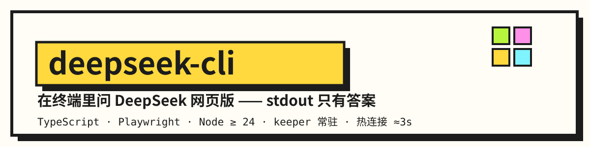
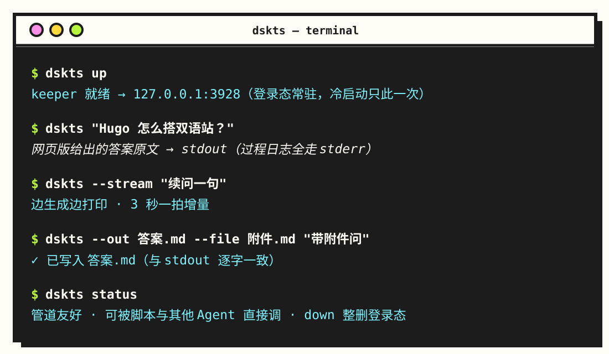
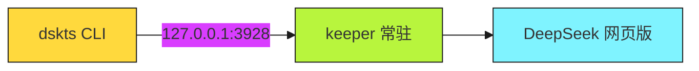

<p align="center">
  
</p>

<p align="center">
  
  &nbsp;
  
  &nbsp;
  
  &nbsp;
  
</p>

> 在终端里问 DeepSeek 网页版：答案打到 <mark>stdout</mark>、过程日志打到 <samp>stderr</samp>，能进管道、能被脚本和其他 Agent 直接调。**不开 API 付费、不建新账号、不撞图形人机验证。**

   

实现只有一份，在 [`dskts/`](dskts/)（TypeScript + Playwright + 常驻 keeper 进程）；用法全表、归属标记规则、架构与安全模型见 [`dskts/README.md`](dskts/README.md)，本文只做入口与全局约定。

> 更早还有一版手写 Marionette 协议的 Python 实现，已被本版取代并移除；它的设计与实测细节留在 `output/`、`docs/` 的历史存档和 git 记录里。

## 快速开始

```bash
dskts up                      # 起实例；未登录会弹窗，登一次即可（登录态常驻）
dskts "你的问题"               # 默认接在本 Agent 的连续会话里问，stdout 只有答案
dskts --stream "你的问题"       # 边生成边打印（3 秒一拍增量）
dskts --out 答案.md "你的问题"  # 答案同时落盘（与 stdout 逐字一致）
dskts --file 附件.md "你的问题" # 挂附件（可重复；类型白名单=页面 input 的 accept）
dskts --max-wait 420 "你的问题" # 等待总上限（默认 240 秒，封顶 3600）
dskts --chat 关键词 "你的问题"  # 指定续问（命中不唯一退 2 并列候选）
dskts chats / rm 关键词 / status / down / whoami
```

日常手感：<kbd>dskts up</kbd> 一次 → <kbd>dskts "问"</kbd> 随便问 → 收工 <kbd>dskts down</kbd> 整删登录态。

需要 Node ≥ 24（靠 type stripping 免构建直接跑 `.ts`），首次用 `npx playwright install firefox` 装浏览器内核。

<p align="center">
  
</p>

## 它是怎么工作的



双进程结构：CLI 进程一次性解析参数、识别调用方，连上常驻的 keeper；keeper 用 Playwright 的 persistent context 驱动一个**独立的 Firefox 实例**，登态落在 `%LOCALAPPDATA%\dsk-ffprofile`，重启机器也在。

为什么常驻：冷启动一次 ≤15s 是硬成本（起浏览器+恢复会话），之后每次提问全走热连接 ≈3s。代价是 keeper 忙时后来命令直接退 2，不排队——串行是这个工具的安全边界，不是缺陷。

<details>
<summary><b>读数与判稳细节</b>（点击展开）</summary>

- 正文只从 `.ds-assistant-message-main-content` 直读，逐字等于页面上人眼看到的答案；
- 「停止」按钮消失 + 正文容器停止增长，双信号判稳才收口；
- 思考过程从 `.ds-think-content` 单独取，不混进 stdout；
- `--max-wait` 触顶时带着已有正文退 2，并在 stderr 写明原因，绝不静默截断。

</details>

## 三条硬规矩

> [!IMPORTANT]
> **不外发**：不往外发正文和未公开设定，只发工具用法、报错原文、通用技术问题。
>
> **不伪造**：不伪造 `bf`、`dltk` 这类反爬令牌，不在浏览器之外重放会话凭据。
>
> **删除设限**：删除只认已知 Agent 前缀的会话，没前缀的一律拒绝（`--any` 是显式动作，才能越过）。

## 怎么验

```bash
node tests/bridge.test.ts    # 顾问桥：协议解析、闸门、EXPECT 判定
node tests/env.test.ts       # 清扫门槛与 sweep.ps1 的编码守卫
node tools/mutate_bridge.mjs # 变异自检：把实现逐条改坏，看有没有用例变红
node tools/probe_prime.ts    # 联网诊断：选择器是否失效、读数健康度
```

三层各自能证明什么不能互相替代：离线测试只证明判定逻辑，联网诊断只证明「现在这个页面还长这样」，唯一算数的端到端判据是 <mark>stdout 逐字等于页面上人眼看到的答案</mark>。

## 目录

| 路径 | 内容 |
| --- | --- |
| `dskts/` | 实现（CLI 入口、keeper 常驻进程、Playwright 页面交互、离线测试、`tools/` 诊断器） |
| `dskts/README.md` | 用法全表、归属标记识别规则、架构一页、宿主环境约束、安全模型 |
| `output/` | dskts 迁移的规划件与 Gate 风控验收记录 |
| `docs/` | 外部评审原文与技术笔记，记着大量实测细节（历史存档） |

<details>
<summary><b>已知软肋与待办</b>（点击展开）</summary>

### 已知软肋

它自动化的是你自己已登录的网页版界面，这未必符合站点的服务条款；账号被限制或静默降级的风险由使用者自己承担。

页面改版会让选择器失效，具体是这几个点：`.ds-assistant-message-main-content`（正文）、`.ds-think-content`（思考）、`.md-code-block-banner-wrap`（代码块横幅）、「停止」按钮。届时要重探，`dskts/tools/probe_prime.ts` 会把污染直接报出来。

一次只允许一条自动化连接：keeper 忙时后来的命令退 2，不排队。

### 待办

- **评估是否并入 `D:\G\github\游览器agent`**（browser-agent 3.0.0 已有 MCP Server、CLI 和插件机制），而不是平行长一套。
- **扩展路线已搁置**：改用 Edge 扩展 + Native Messaging、直接拿页面响应流而非从 DOM 取词。它原要解决的三个问题里，凭据落盘已由「常驻 profile + 显式 down 整删」解决，冷启动慢已由「keeper 常驻 + 热连接」解决，剩下的「DOM 取词、改版要重摸」暂不构成换路线的理由。触发重开的条件：响应流拿不到，或选择器频繁失效。

</details>

---

<p align="center">
  <a href="https://lll-404.github.io/"><b>🌍 lll-404.github.io</b></a> ·
  <a href="https://github.com/LLL-404"><b>GitHub</b></a> ·
  <a href="mailto:2350178663@qq.com"><b>📧 邮箱</b></a>
</p>
