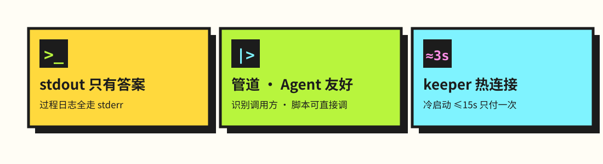
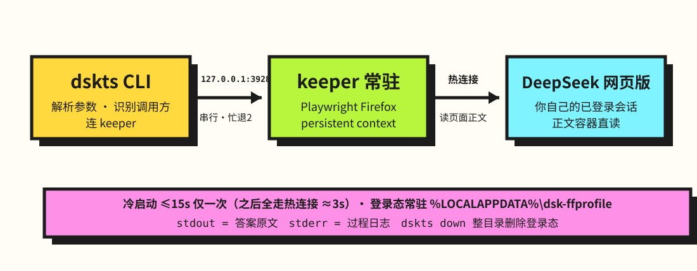
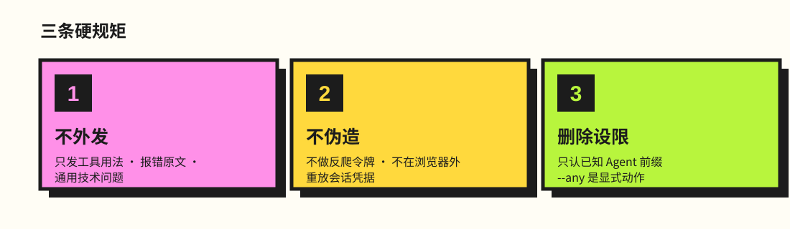

<p align="center">
  
</p>

<p align="center">
  
  &nbsp;
  
  &nbsp;
  
  &nbsp;
  
</p>

> 在终端里问 DeepSeek 网页版：**答案打到 stdout、过程日志打到 stderr**，不开 API 付费、不建新账号、不撞图形人机验证。

<p align="center">
  
</p>

实现只有一份，在 [`dskts/`](dskts/)（TypeScript + Playwright + 常驻 keeper 进程）；用法全表、归属标记规则、架构与安全模型见 [`dskts/README.md`](dskts/README.md)。更早有一版手写 Marionette 协议的 Python 实现，已被本版取代并移除，细节留在 `output/`、`docs/` 历史存档和 git 记录里。

## 快速开始

    dskts up                      # 起实例；未登录会弹窗，登一次即可（登录态常驻）
    dskts "你的问题"               # 默认接在本 Agent 的连续会话里问，stdout 只有答案
    dskts --stream "你的问题"       # 边生成边打印（3 秒一拍增量）
    dskts --out 答案.md "你的问题"  # 答案同时落盘（与 stdout 逐字一致）
    dskts --file 附件.md "你的问题" # 挂附件（可重复；类型白名单=页面 input 的 accept）
    dskts --max-wait 420 "你的问题" # 等待总上限（默认 240 秒，封顶 3600）
    dskts --chat 关键词 "你的问题"  # 指定续问（命中不唯一退 2 并列候选）
    dskts chats / rm 关键词 / status / down / whoami

<p align="center">
  
</p>

需要 Node ≥ 24（靠 type stripping 免构建直接跑 `.ts`），首次用 `npx playwright install firefox` 装浏览器。入口桩已装到 `~/.qoder-cn/bin/`（`dsk` / `dsk.cmd` / `dskts-launch.mjs`），PATH 上可直接用 `dsk` 调用，与 `dskts` 完全等价；下面示例仍写作 `dskts`。

## 它是怎么工作的

<p align="center">
  
</p>

双进程：**CLI**（`dskts/src/dskts.ts`）解析参数、识别本次是哪个 Agent 在调用、连 keeper；**keeper**（`dskts/src/keeper.ts`）常驻，持有 Playwright 的 Firefox persistent context，监听 `127.0.0.1:3928`，命令串行、忙时退 2 不排队。keeper 必须常驻的原因很具体：Playwright 的 Firefox **不支持二次连接已启动的浏览器**，每次调用都重开实例会把冷启动成本摊在每一次问答上。

<details>
<summary><b>读数与判稳的细节</b>（点击展开）</summary>

答案取的是页面自己的正文容器 `.ds-assistant-message-main-content`，思考过程在兄弟容器 `.ds-think-content` 里，所以天然不混入独白；代码块横幅在正文容器内部，读数前临时隐藏、读完还原。判「这一问答完没有」要两个信号同时点头：正文文本连续几拍不变 **且** 页面上的「停止」按钮已消失——只看文本稳不稳，生成中途一停顿就会把半截答案当成成品、退出码还是 0。

登录态常驻 `%LOCALAPPDATA%\dsk-ffprofile`（不再是每次复制副本），`dskts down` 关闭浏览器并**整目录删除**（含全部登录态）。

</details>

## 三条硬规矩

<p align="center">
  
</p>

## 怎么验

```
cd dskts
npx tsc --noEmit            # 类型检查
node tests/judge.test.ts    # 离线测试共 104 项，注入假读数，不起浏览器
node tests/frame.test.ts
node tests/agent.test.ts
node tests/bridge.test.ts   # 顾问桥：协议解析、闸门、EXPECT 判定
node tests/env.test.ts      # 清扫门槛与 sweep.ps1 的编码守卫
node tools/mutate_bridge.mjs # 变异自检：把实现逐条改坏，看有没有用例变红
node tools/probe_prime.ts   # 联网诊断：选择器是否失效、读数健康度
```

三层各自能证明什么不能互相替代：离线测试只证明判定逻辑，联网诊断只证明「现在这个页面还长这样」，唯一算数的端到端判据是 stdout 逐字等于页面上人眼看到的答案。

## 目录

| 路径 | 是什么 |
|---|---|
| `dskts/` | 全部实现代码（`src/` 源码、`bin/` 入口桩、`tests/` 离线测试、`tools/` 诊断器） |
| `dskts/README.md` | 用法全表、归属标记识别规则、架构一页、宿主环境约束、安全模型 |
| `output/` | dskts 迁移的规划件与 Gate 风控验收记录 |
| `docs/` | 外部评审原文与技术笔记，记着大量实测细节（历史存档） |

<details>
<summary><b>已知软肋与待办</b>（点击展开）</summary>

### 已知软肋

它自动化的是你自己已登录的网页版界面，这未必符合站点的服务条款；账号被限制或静默降级的风险由使用者自己承担。

页面改版会让选择器失效，具体是这几个点：`.ds-assistant-message-main-content`（正文）、`.ds-think-content`（思考）、`.md-code-block-banner-wrap`（代码块横幅）、「停止」按钮。届时要重探，`dskts/tools/probe_prime.ts` 会把污染直接报出来。

一次只允许一条自动化连接：keeper 忙时后来的命令退 2，不排队。

### 待办

- **评估是否并入 `D:\G\github\游览器agent`**（browser-agent 3.0.0 已有 MCP Server、CLI 和插件机制），而不是平行长一套。
- **扩展路线已搁置**：改用 Edge 扩展 + Native Messaging、直接拿页面响应流而非从 DOM 取词。它原要解决的三个问题里，凭据落盘已由「常驻 profile + 显式 down 整删」解决，冷启动慢已由「keeper 常驻 + 热连接」解决，剩下的「DOM 取词、改版要重摸」暂不构成换路线的理由。触发重开的条件：响应流拿不到，或选择器频繁失效。

</details>

---

<p align="center">
  <a href="https://lll-404.github.io/"><b>🌍 lll-404.github.io</b></a> ·
  <a href="https://github.com/LLL-404"><b>GitHub</b></a> ·
  <a href="mailto:2350178663@qq.com"><b>📧 邮箱</b></a>
</p>
